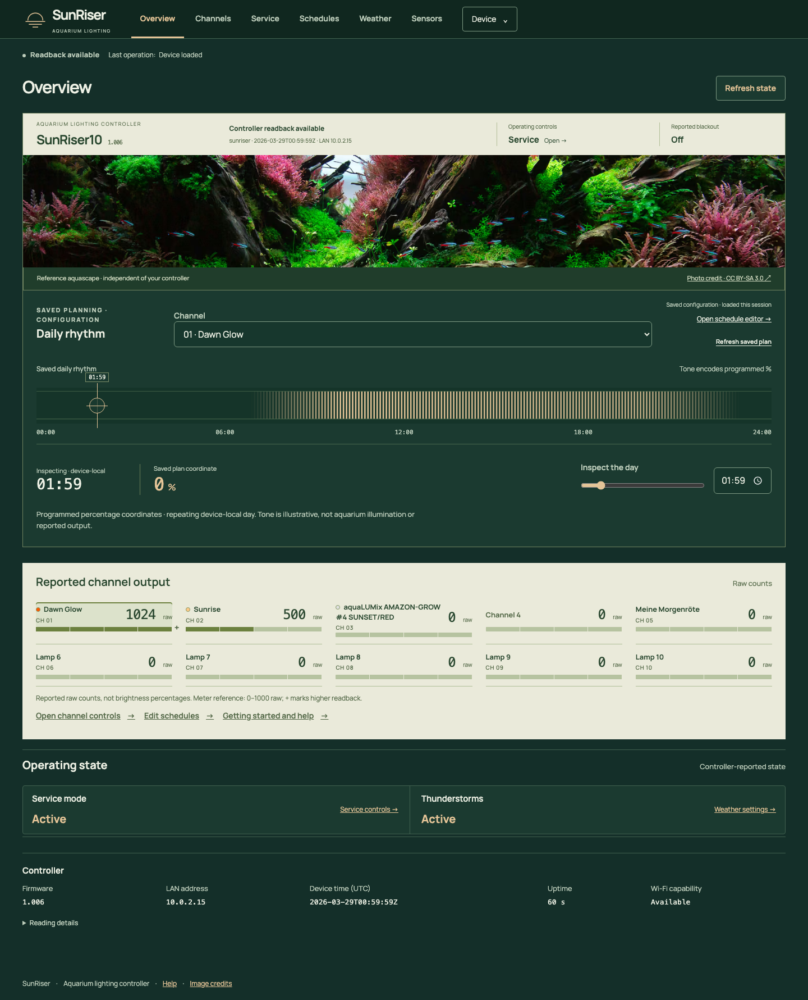
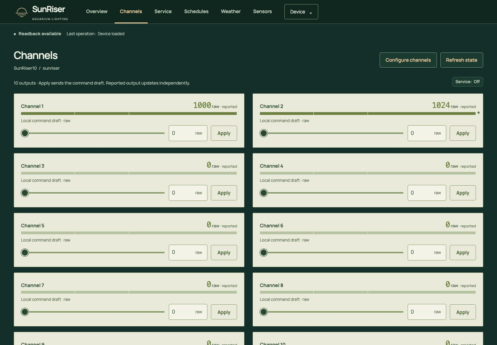
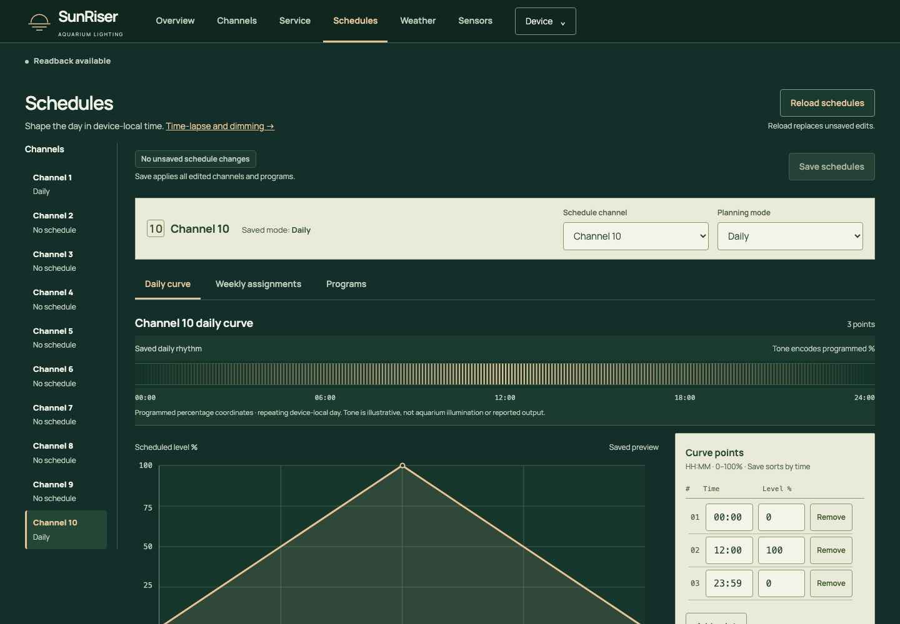
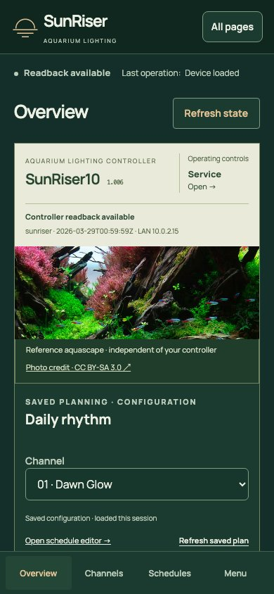

# SunRiser modern web interface

The Living Aquascape Svelte frontend for SunRiser 8 and 10, extracted into a
standalone project. It communicates with the controller's existing HTTP API.
All fonts, images and notices are local.

Current Overview polish and configuration-synchronisation notes: [validation report](docs/OVERVIEW_SYNC.md).

## Screenshots

Desktop and mobile views of Living Aquascape using demonstration data. Select an
image to view it at full resolution.

### Overview

[](docs/screenshots/overview-desktop.png)

### Channel controls

[](docs/screenshots/channels-desktop.jpg)

### Schedule editor

[](docs/screenshots/schedules-desktop.jpg)

### Mobile Overview

<a href="docs/screenshots/overview-mobile.jpg"></a>

Aquascape photograph: *Positive nihilism-2, 2021 IIAC R.25, RFLAC R.14* by 조재선,
[CC BY-SA 3.0](assets/photo/CC-BY-SA-3.0.txt). The screenshots include the existing
cropped and optimised adaptation; [source and attribution](assets/photo/ATTRIBUTION.txt).
The photograph depicts a reference aquascape, independently of controller output.

## Build

Requires Node.js 22.12 or newer and Python 3.10 or newer.

**No firmware binaries are included in this repository.** Download the original
[vendor NEW.BEE](http://sunriser.ledaquaristik.de/NEW.BEE), check its SHA-256,
and place it at the repository root as `NEW.BEE`.

The supported input is the original **v1.007** package with SHA-256:

```text
725b39aba735740b55e51c06f9626f4949454d37fe4678f72583b0d6e2415377
```

For example, from the repository root on macOS:

```sh
curl --fail --location --output NEW.BEE.download http://sunriser.ledaquaristik.de/NEW.BEE
printf '%s\n' '725b39aba735740b55e51c06f9626f4949454d37fe4678f72583b0d6e2415377  NEW.BEE.download' | shasum -a 256 -c - &&
  mv NEW.BEE.download NEW.BEE
```

Proceed only if the checksum prints `OK`. On Linux, use `sha256sum -c -`
instead of `shasum -a 256 -c -`. The vendor URL may later serve another release;
a different hash is rejected until that release is explicitly supported.

Then build:

```sh
npm ci --ignore-scripts
npm run check
npm run build
npm test
```

Outputs:

- `dist/`: the static website.
- `build/NEW.BEE`: the modern website with **original vendor v1.007 C firmware**.
- `build/SHA256SUMS`: the package checksum.
- `build/package.json`: firmware provenance and web asset hashes.

`npm run verify` independently checks the CDB lookup tables, all retained vendor
records and every packaged website asset against `dist/`.
The scripts recheck the input hash automatically. The downloaded root `NEW.BEE`
is read-only input; output goes to `build/NEW.BEE`. Both are Git-ignored.
No download happens automatically during a build.

## Firmware contents

The build takes the 51 non-website records directly from your hash-verified
root `NEW.BEE`. It replaces only the website: the original SR8/SR10 applications,
bootloader records, metadata and defaults are retained byte for byte. Only the
supported version, download URL and expected hash are stored in `scripts/vendor.json`.

The resulting `NEW.BEE` has a different hash from the vendor package because its
website is different. Its normal device update path installs the C application;
including bootloader records does not mean the updater replaces the bootloader.

This extraction and package verification do not establish physical-device
readiness or full frontend compatibility with every v1.007 behavior.
No device is updated by these build commands.

The initial extracted build passed type checking, package-integrity tests and
focused checks on disposable SR8/SR10 v1.007 host C simulators: all ten assets
served byte-identically, Chromium startup, hostname save and restart persistence.
These are focused host tests, not the original workspace's complete acceptance
suite. Simulators and browser tooling are not dependencies of this repository.
The subsequent source synchronisation recorded in `provenance.json` passed type
checking, a fresh build and all six package-integrity tests. Its generated
JavaScript and CSS match the modern frontend's isolated build; the earlier
simulator/browser checks were not repeated for this synchronisation.

## Local development

```sh
npm run dev
# Or serve the production build:
npm run preview
```

These commands serve the frontend only. Device operations require the existing
SunRiser API at the same origin; a static preview alone has no controller.
The packaged website is intended to be served by the controller or an isolated
simulator. No device address or automatic connection is configured here.

## Source and licences

The frontend snapshot is identified in `provenance.json`. It is independent of
the original workspace; later redesign changes are not synchronised automatically.
The record lists intentional standalone adaptations alongside the source revision
and snapshot hash. Packaging remains specific to this repository and the verified
vendor v1.007 input.

Copyright © 2026 Aedan Lawrence. Original contributions to this frontend are
licensed under [GNU GPLv3 or later](LICENSE). Third-party material retains its
respective copyright and licence.

SunRiser-derived code and configuration retain the original project’s GNU GPL v3
terms. Original firmware and workflow attribution includes Torsten Raudssus and
the [SunRiser project](https://github.com/LEDaquaristik/sunriser).
Firmware bytes come directly from the verified vendor package.
The combined application's package metadata is `GPL-3.0-only`; the upstream
grant does not explicitly include later versions. Your original contributions
remain `GPL-3.0-or-later`. See [LICENSING.md](LICENSING.md) for the file-level
scope, upstream licensing statement and separate asset terms.

The embedded Manrope font is under the SIL Open Font License. The photograph and
its adaptations are CC BY-SA 3.0; see `assets/` for credits and licence texts.
Bundled Svelte and MessagePack notices are generated from the pinned dependencies
into `public/notices.html`. Run `python3 scripts/notices.py` after a deliberate
dependency or licence update, then review the changes.
