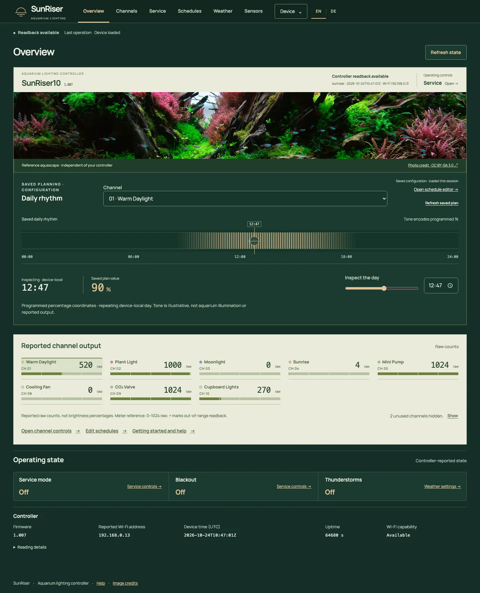
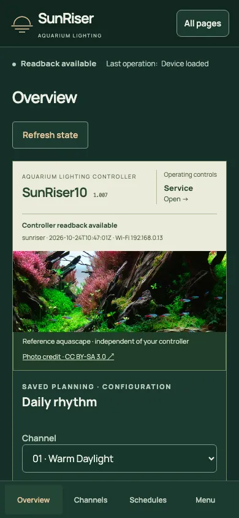
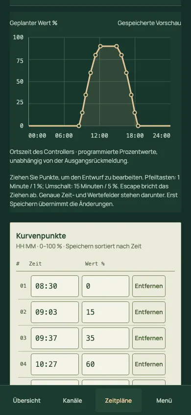

# SunRiser modern web interface

A responsive frontend for **SunRiser 8 and 10 aquarium lighting controllers**, built
with Svelte and TypeScript. It uses the original controller’s HTTP/MessagePack API;
no separate backend, cloud account or remote assets are required by the frontend.

[](docs/screenshots/overview-desktop-en.webp)

*Current application with SR10 readback (firmware 1.007), captured on 23 October
2026. The photograph is a reference aquascape, not a live view; the saved lighting
rhythm is separate from reported output.*

## Features

- Named channel readback and precise manual drafts with explicit **Apply**.
- Daily curves, weekly programmes, numeric point editing and copy/shift tools.
- Service mode, blackout and configurable clouds, rain, thunderstorms and moonlight.
- Sensor readings, corrections, thresholds, channel responses and confirmed removal.
- Clock, network, lighting tools, diagnostics and Help.
- Controller-aware getting-started guidance and an explicit saved-settings summary.
- Backups, reviewed restores and separately confirmed firmware/reset operations.

**English and German:** the compact **EN / DE** control remembers your preference.
English is the default; switching languages preserves drafts and sends no device
requests. Fonts, translations and photography are bundled locally.

One consistent startup panel explains layout/font loading, interface setup and
controller reads. Help, Diagnostics, Recovery and Lighting tools download on
first visit and remain mounted afterwards, retaining drafts across navigation.
The Help summary is read explicitly and warns when a verified save makes it old.

<a href="docs/screenshots/overview-mobile-en.webp"></a>
<a href="docs/screenshots/schedules-mobile-de.webp"></a>

[More screenshots](docs/screenshots/README.md): Channels, desktop/mobile Schedules,
Weather, Sensors and German Overview. Select any image for its full resolution.

## Compatibility and safety

Targets **SR8/SR10**. Firmware **1.006** has broad frontend coverage in isolated
firmware-derived C simulators. **1.007** is the verified packaging input, with
raw-PWM and sensor-removal contract probes on both boards. Firmware chunk retries
preserve staged-file bytes in native C tests on both boards and both releases.
Complete frontend/hardware qualification remains incomplete. Other models/releases
are unverified.

Raw commands/meters use **0–1024**; firmware still applies configured limits
(ordinary dimming defaults to **1000**). Percentage settings remain independent.
Reported state, saved configuration and local drafts are distinct. Writes require
explicit actions. On running firmware **1.006/1.007**, a failed upload chunk may
retry up to three times, with the same bytes and offset, increasing delays and a
45-second budget. Upload initialization, installation and all other writes are
never automatically retried. Acknowledgement does not prove a physical output
changed. The webapp cannot pause Home Assistant traffic; physical SR10 Wi-Fi
contention remains unqualified.

Use a trusted network and retain backups. Network, clock, restore and firmware
operations can interrupt aquarium control or access. Read the warnings and verify
uncertain outcomes before resubmitting. Existing firmware HTTP limitations remain;
Wi-Fi access-point scanning is unsupported.

## Build and installation

Requires **Node.js 22.12+** and **Python 3.10+**.
Download the original [vendor v1.007 NEW.BEE](http://sunriser.ledaquaristik.de/NEW.BEE)
to the repository root as `NEW.BEE`. Firmware binaries are not tracked here.
The build verifies this exact SHA-256 and rejects other input:

```text
725b39aba735740b55e51c06f9626f4949454d37fe4678f72583b0d6e2415377
```

```sh
npm ci --ignore-scripts
npm run check
npm run build
npm test
```

Outputs: `dist/` contains the static site; `build/NEW.BEE` is the installable
package. `build/SHA256SUMS` and `build/package.json` record its checksum/provenance.
All **51 non-website vendor records** are retained byte for byte. `npm run verify`
independently checks them and the packaged website. Builds never download or deploy.

**Installation is a firmware update, not a website-only upload:** the package
contains original **v1.007 C applications**. Confirm the
model/version, back up configuration and use the controller’s documented update
procedure. In an existing modern interface: **Device → Recovery → Local firmware**,
select `build/NEW.BEE`, then **Review firmware update**. Follow the confirmation
warnings, keep power stable and check device readback afterward. Routine updates
do not require replacing the factory/recovery image.

## Development and testing

```sh
npm run dev      # local development server
npm run preview  # production preview; build first
npm run verify   # package integrity; build first
```

These servers bind loopback and provide no simulated API. Controller operations
need the existing API at the same origin; no physical-device connection is
configured. Edit `src/locales/en.ts` and `de.ts` together; `npm run check` validates
keys, placeholders, missing translations, copied English, fixed UI prose, Svelte
and TypeScript. Intentional shared terms and technical literals are documented in
`src/locales/exemptions.json`; stale exemptions fail the check. Retained messages
keep their keys and nested parameters until rendering, while user text stays
verbatim. These development checks add no device requests.

`npm test` runs six packaging/integrity tests. Broader browser and SR8/SR10 native
simulator tests are maintained separately in the development workspace.
Simulator/browser results are not physical-device validation.

## Credits and licences

Built on [SunRiser](https://github.com/LEDaquaristik/sunriser), its contributors,
including **Torsten Raudssus**, and LEDaquaristik hardware/firmware. Modern frontend:
**Aedan Lawrence**. [provenance.json](provenance.json) identifies the source snapshot.

Combined application: **GPL-3.0-only**; original contributions also available under
**GPL-3.0-or-later**. See [LICENSE](LICENSE), [LICENSING.md](LICENSING.md) and bundled
[third-party notices](public/notices.html), including Manrope (OFL), Svelte (MIT)
and MessagePack (ISC).

Aquascape: *Positive nihilism-2, 2021 IIAC R.25, RFLAC R.14* by **조재선**,
[original source](https://commons.wikimedia.org/wiki/File:Positive_nihilism-2,_2021_IIAC_R.25,_RFLAC_R.14.jpg),
[CC BY-SA 3.0](https://creativecommons.org/licenses/by-sa/3.0/).
[Attribution and modifications](assets/photo/ATTRIBUTION.txt) cover the cropped,
resized and format-converted photograph, including its appearance in screenshots.
Adaptations retain CC BY-SA 3.0; keep the credits when redistributing. No endorsement
is implied.
